<div align="center">

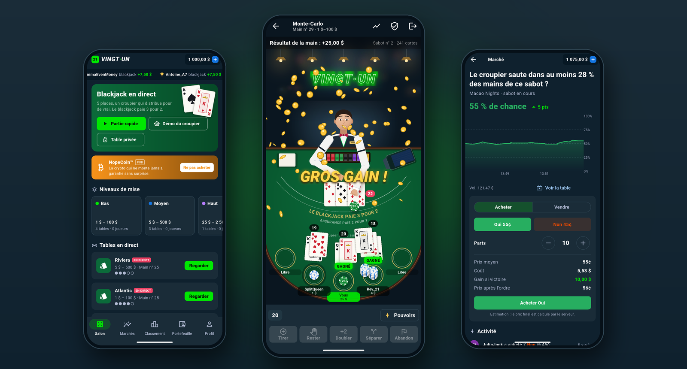

# Vingt·Un

### Le blackjack multijoueur en direct, avec un croupier qui distribue pour de vrai.<br>Et ceux qui regardent parient sur la main en cours.

[](https://github.com/PierreOlivierBrillant/vingt-un-blackjack/actions/workflows/ci.yml)


**Français · English** — thème sombre ou clair — 83 effets sonores — zéro asset graphique externe

</div>

---

## Vingt·Un en 30 secondes

Vingt·Un est une **application mobile Android** de blackjack où **jusqu'à cinq joueurs** s'assoient à la même table face à un **croupier animé**. Il tire les cartes du sabot, les distribue, retourne sa carte cachée et ramasse les jetons, le tout dessiné en code.

Autour de la table, les **spectateurs** misent sur la main en cours (« Le croupier saute ? », « Un blackjack naturel ? ») comme sur un **marché de prédictions**, avec des cotes qui bougent en direct.

Tout l'argent est **fictif** et tout tourne **en local** sur les émulateurs Firebase. Un poste enseignant suffit pour faire jouer une classe entière.

<table>
<tr>
<td align="center" width="25%"><h3>🎩</h3><b>Un vrai croupier</b><br><sub>Personnage vectoriel animé : bras articulés, cartes en vol, réactions.</sub></td>
<td align="center" width="25%"><h3>👥</h3><b>Une table partagée</b><br><sub>5 places, matchmaking par niveau de mise, bots qui cèdent leur siège.</sub></td>
<td align="center" width="25%"><h3>📈</h3><b>Les spectateurs parient</b><br><sub>Parts Oui/Non cotées en ¢, graphique de prix, positions.</sub></td>
<td align="center" width="25%"><h3>🛡️</h3><b>Impossible à truquer</b><br><sub>Serveur autoritaire, mélange vérifiable par SHA-256.</sub></td>
</tr>
</table>

---

## 🃏 Asseyez-vous à la table

Choisissez « Partie rapide » : en quelques secondes vous êtes assis avec d'autres joueurs. Misez avec les jetons, puis **Tirer, Rester, Doubler, Séparer ou Abandonner** avant la fin du compte à rebours. Le croupier distribue chaque carte en suivant une trajectoire, et il réagit quand il saute ou quand quelqu'un sort un blackjack. Les gros gains finissent sous une pluie de pièces.

<table>
<tr>
<td align="center">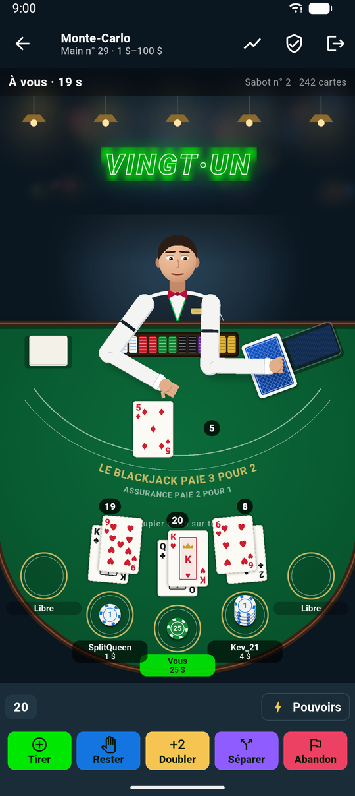</td>
<td align="center">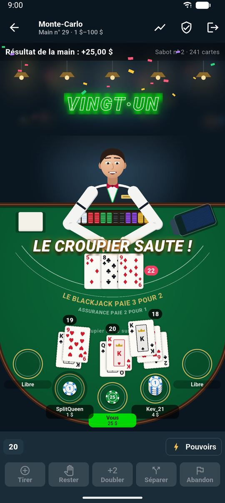</td>
<td align="center">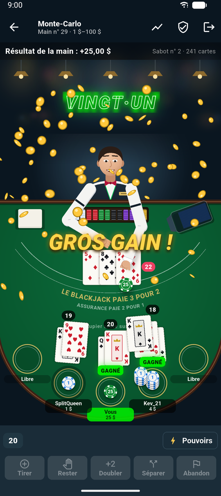</td>
</tr>
<tr>
<td align="center"><sub><b>À vous de jouer</b> : 20 secondes pour décider</sub></td>
<td align="center"><sub><b>Le croupier saute !</b></sub></td>
<td align="center"><sub><b>Gros gain</b> : +25 $ et pluie de pièces</sub></td>
</tr>
</table>

- **Salon vivant** : tables en direct, bandeau des derniers gains, trois niveaux de mise (1–100 $, 5–500 $, 25–2 500 $).
- **Tables privées** : un code à partager pour jouer entre amis.
- **Ambiance casino** : néon, lampes, tapis, jetons, 83 sons synthétisés (cartes, jetons, foule, jackpot), retour haptique.

---

## ⚡ Des pouvoirs pour tordre le destin

Une boutique de cinq pouvoirs, payés en argent fictif, **un par main** et toujours validés par le serveur.

<table>
<tr>
<td align="center">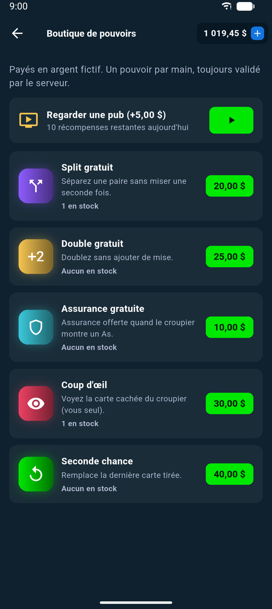</td>
<td>

| Pouvoir | Effet |
|---|---|
| ✂️ **Split gratuit** | Séparez une paire sans miser une seconde fois. |
| ➕ **Double gratuit** | Doublez sans ajouter de mise. |
| 🛡️ **Assurance gratuite** | Assurance offerte quand le croupier montre un As. |
| 👁️ **Coup d'œil** | Voyez la carte cachée du croupier (vous seul). |
| 🔄 **Seconde chance** | Remplacez la dernière carte tirée. |

Fauché ? Regardez une **fausse pub récompensée** pour gagner quelques dollars fictifs.

</td>
</tr>
</table>

---

## 📈 Pas à la table ? Pariez depuis les gradins

Chaque table en direct ouvre des **marchés de prédictions** : « Le croupier saute ? », « Un blackjack naturel ? », « {Joueur} gagne ? », et un marché long sur tout le sabot. On achète des parts **Oui** ou **Non** cotées en cents. Une part gagnante paie 1,00 $. Les prix bougent à chaque ordre, calculés côté serveur par un teneur de marché automatique (LMSR).

<table>
<tr>
<td align="center">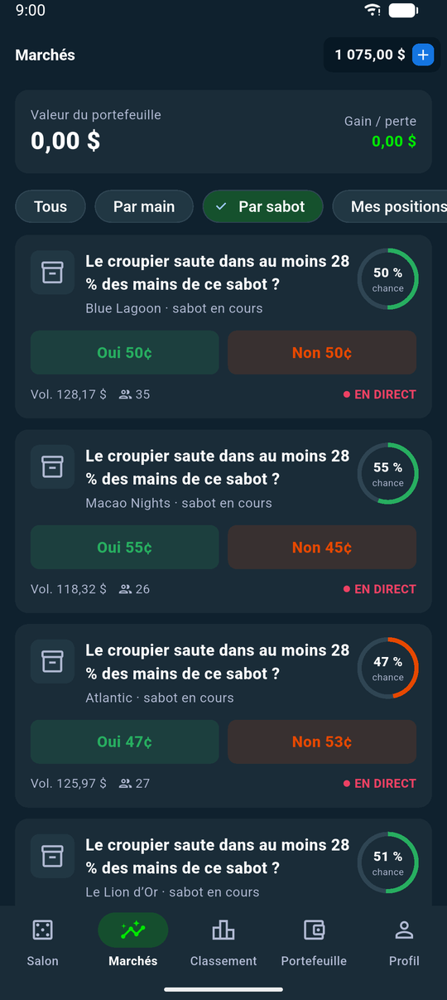</td>
<td align="center">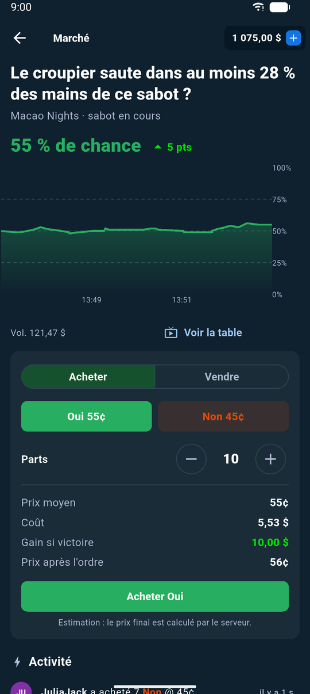</td>
<td align="center">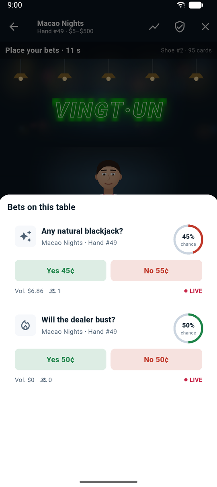</td>
</tr>
<tr>
<td align="center"><sub><b>Tous les marchés</b> en direct</sub></td>
<td align="center"><sub><b>Graphique de prix</b> et ticket d'ordre</sub></td>
<td align="center"><sub><b>Mode spectateur</b> : on regarde, on parie</sub></td>
</tr>
</table>

Les marchés ferment **avant** que le croupier ne révèle sa carte, et on ne peut pas parier sur sa propre table.

---

## 🏆 Grimpez au classement, jouez entre amis

Chaque main rapporte des points (victoire +10, blackjack +15, égalité +2, défaite −4) pour grimper de **Bronze à Diamant**. Le classement existe en version globale, entre amis ou de la semaine.

<table>
<tr>
<td align="center">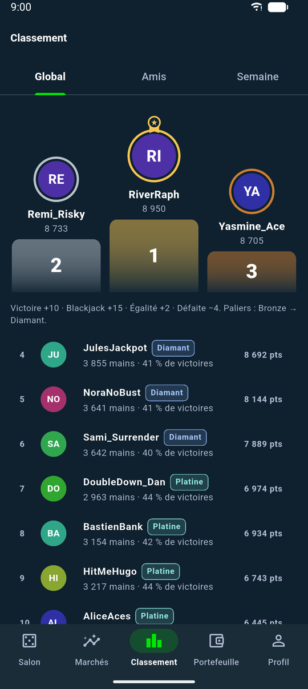</td>
<td align="center">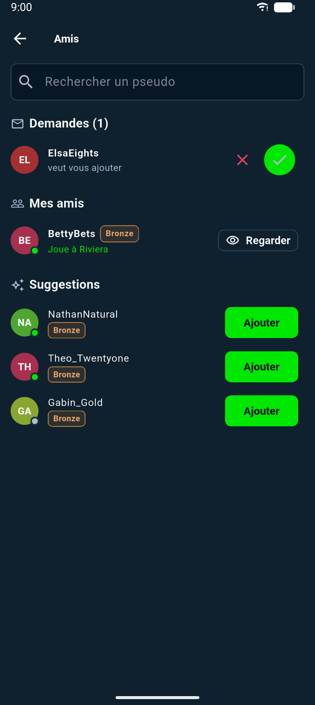</td>
</tr>
<tr>
<td align="center"><sub><b>Podium</b> et paliers</sub></td>
<td align="center"><sub><b>Amis</b> : un ami joue ? <b>Regarder</b></sub></td>
</tr>
</table>

Recherchez un pseudo, envoyez une demande, voyez qui est en ligne, puis rejoignez la table d'un ami en spectateur.

---

## 💳 Un portefeuille réaliste… et totalement fictif

1 000 $ fictifs offerts à l'inscription. Pour déposer ou retirer, une **vérification d'identité simulée** avec un faux scan animé, refusée aux moins de 18 ans. Le formulaire de paiement utilise un **numéro de test pré-rempli et non modifiable**. Aucune donnée bancaire n'est demandée ni transmise.

<table>
<tr>
<td align="center">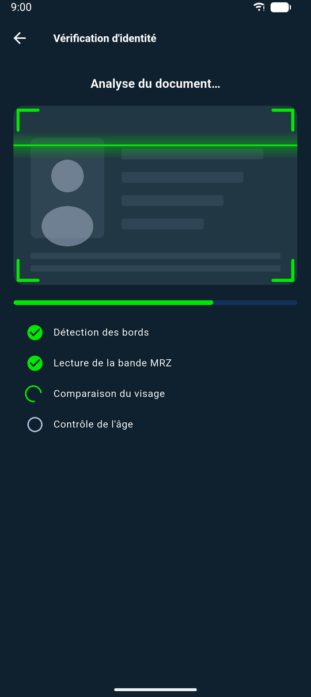</td>
<td align="center">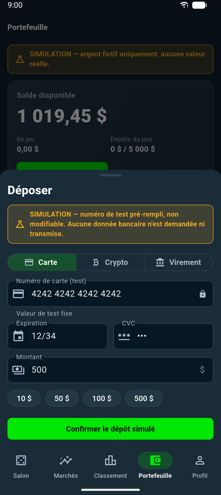</td>
<td align="center">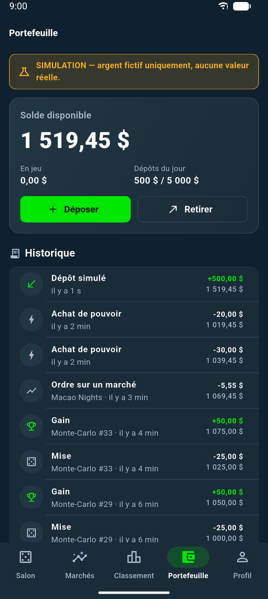</td>
</tr>
<tr>
<td align="center"><sub><b>KYC simulé</b> en 4 étapes</sub></td>
<td align="center"><sub><b>Dépôt</b> carte, crypto ou virement</sub></td>
<td align="center"><sub><b>Historique</b> complet du grand livre</sub></td>
</tr>
</table>

---

## 🎨 À votre style

<table>
<tr>
<td align="center">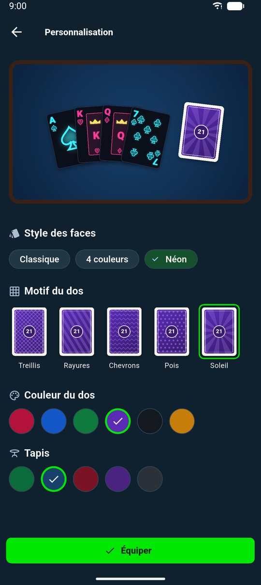</td>
<td align="center">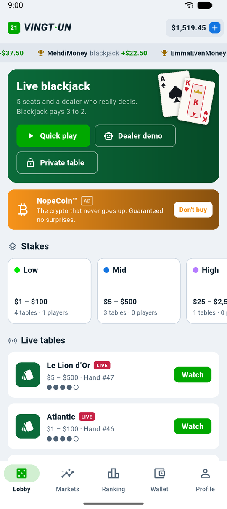</td>
<td align="center">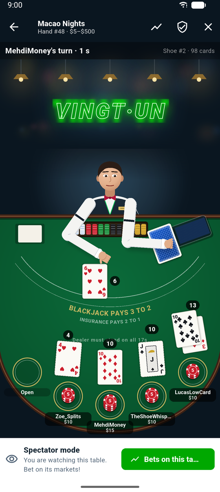</td>
</tr>
<tr>
<td align="center"><sub><b>Cartes</b> : faces, dos, couleurs, tapis</sub></td>
<td align="center"><sub><b>Thème clair</b>, sombre ou système</sub></td>
<td align="center"><sub><b>Français ou anglais</b>, en un toucher</sub></td>
</tr>
</table>

Faces classiques, quatre couleurs ou **néon**. Cinq motifs de dos, six couleurs, cinq tapis, avec aperçu en direct.

---

## 🛡️ Équité vérifiable, sécurité stricte

<table>
<tr>
<td align="center" width="260">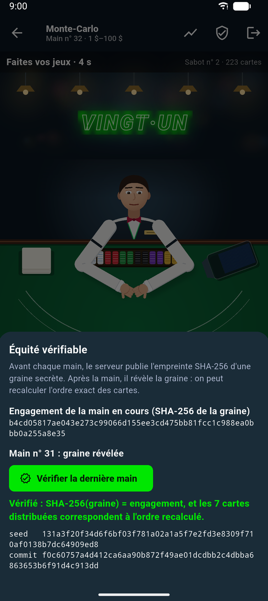</td>
<td>

**Provably fair.** Avant chaque main, le serveur publie l'empreinte SHA-256 d'une graine secrète. Après la main, il révèle la graine. Un bouton dans l'app recalcule l'ordre exact des cartes et confirme que rien n'a été changé.

**Le client ne décide de rien.** L'app lit l'état en temps réel et appelle des fonctions serveur. Elle n'écrit jamais d'argent, de cartes, de paris ni de classement.

- Chaque action est validée (schéma strict, tour, siège, phase) et exécutée en **transaction**.
- **Idempotence** et **limitation de débit** par joueur.
- Le sabot et la carte cachée sont illisibles par tous les clients (règles Firestore testées).
- Mélange Fisher-Yates avec un générateur cryptographique.

</td>
</tr>
</table>

---

## 📺 Et des pubs… parodiques

Bannières, interstitiels et vidéos récompensées, sans lien ni pistage. Aucune de ces marques n'existe :

> **NopeCoin™** : la crypto qui ne monte jamais, garantie sans surprise. *[Ne pas acheter]*<br>
> **Banque Imaginaire** : des intérêts imaginaires sur votre argent imaginaire.<br>
> **ToasterGPT** : le grille-pain qui répond à vos e-mails. Mal.<br>
> **PixelPets NFT** : adoptez un pixel. Il ne fait rien, mais il est unique.

---

## 🏫 Conçu pour la salle de classe

Tous les étudiants jouent ensemble, chacun sur l'émulateur Android de son poste, contre le serveur du poste enseignant.

| | Ce qu'on fait | Ce qui se passe |
|---|---|---|
| **Enseignant** | `tools\start_classroom.ps1` | Détecte l'IP du poste, démarre les émulateurs Firebase avec les données, lance les bots, construit l'APK et publie une page d'installation sur `http://<IP>:8088`. |
| **Étudiant** | Une commande copiée depuis cette page | Démarre l'émulateur si besoin, télécharge l'APK, vérifie son SHA-256, l'installe et ouvre l'app. |

Les étudiants d'un même niveau de mise se retrouvent à la même table, et les bots ne font que compléter. Un **code de table privée** permet de s'asseoir ensemble volontairement. Les scripts ne modifient jamais le pare-feu : ils indiquent seulement quoi ouvrir.

---

## ⚙️ Sous le capot

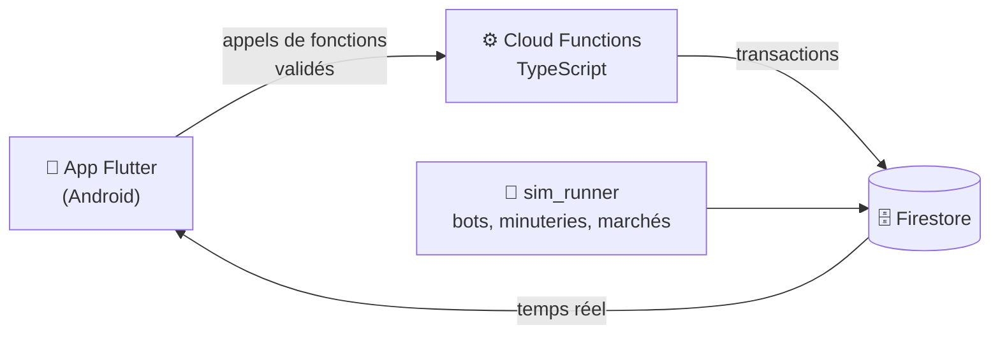

| Couche | Technologies |
|---|---|
| **App** | Flutter 3.44 / Dart 3.12, Riverpod, go_router, fl_chart, audioplayers, i18n FR/EN |
| **Serveur** | Firebase Auth, Firestore et Cloud Functions (TypeScript, zod), tous en **émulateurs locaux** (projet `demo-blackjack`, aucun identifiant réel) |
| **Moteur** | Blackjack pur et LMSR pur, sans dépendance Firebase |
| **Graphismes** | 100 % procéduraux : croupier, cartes, jetons et décor dessinés en `CustomPainter` |
| **Sons** | 83 effets synthétisés par script (`tools/sfx`) |

**Testé de partout** : près de 400 tests automatisés.

- Moteur : chaque règle et chaque paiement, tests de propriétés (pas de doublon dans le sabot, conservation de l'argent), mains « golden » à graine fixe, Monte-Carlo de l'avantage maison.
- Règles Firestore, en positif comme en négatif.
- Intégration multi-clients sur émulateurs : double dépense, rejeu, action hors tour.
- Widgets et captures « golden » clair/sombre.
- Un parcours complet de bout en bout sur un émulateur Android.

---

## 🚀 Démarrer en local

**Prérequis** : Flutter 3.44, Node 24, Java 21, Firebase CLI, SDK Android avec un AVD.

```powershell
npm ci --prefix firebase/functions
```

```powershell
cd app; flutter pub get; cd ..
```

Dans trois terminaux :

```powershell
powershell -ExecutionPolicy Bypass -File tools\run_emulators.ps1
```

```powershell
powershell -ExecutionPolicy Bypass -File tools\sim_runner.ps1
```

```powershell
cd app; flutter run -d emulator-5554
```

`sim_runner` remplit la base au premier lancement : 60 joueurs fictifs, 8 tables vivantes, classement et suggestions d'amis. L'app joint les émulateurs via `10.0.2.2`, une adresse modifiable sur l'écran de connexion (« Serveur »).

Tous les tests : `tools\test_all.ps1`.

---

## 📜 Règles de la maison

| Règle | À Vingt·Un |
|---|---|
| Sabot | 6 jeux, remélangé vers 75 % |
| Croupier | Vérifie le blackjack, **reste sur tout 17** |
| Blackjack | Payé **3 pour 2** |
| Assurance | Jusqu'à la moitié de la mise, payée **2 pour 1** |
| Doubler | Sur deux cartes quelconques, aussi après un split |
| Séparer | Jusqu'à 4 mains ; As séparés : une carte chacun |
| Abandon | Tardif, sur les deux premières cartes |
| Rythme | 15 s pour miser, 20 s par décision |

---

<div align="center">

**Vingt·Un est un projet pédagogique.**<br>
Argent 100 % fictif : aucun gain réel, aucun paiement réel, aucune donnée bancaire.<br>
L'app tourne uniquement sur des émulateurs locaux et n'est pas faite pour être exposée sur Internet.

</div>
